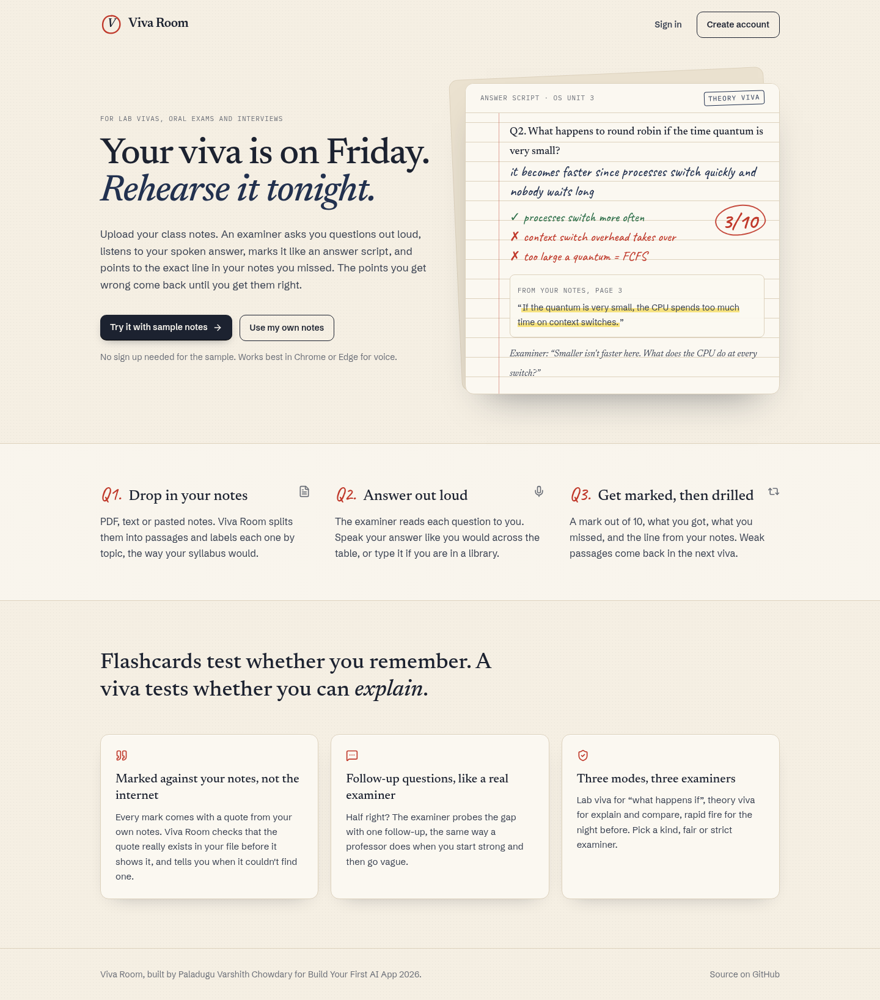
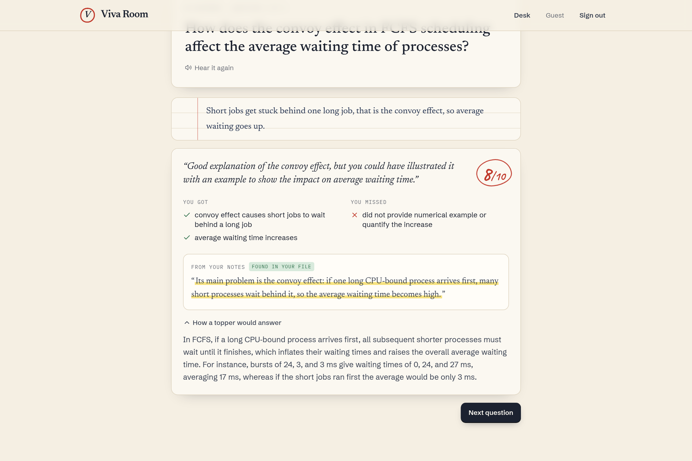
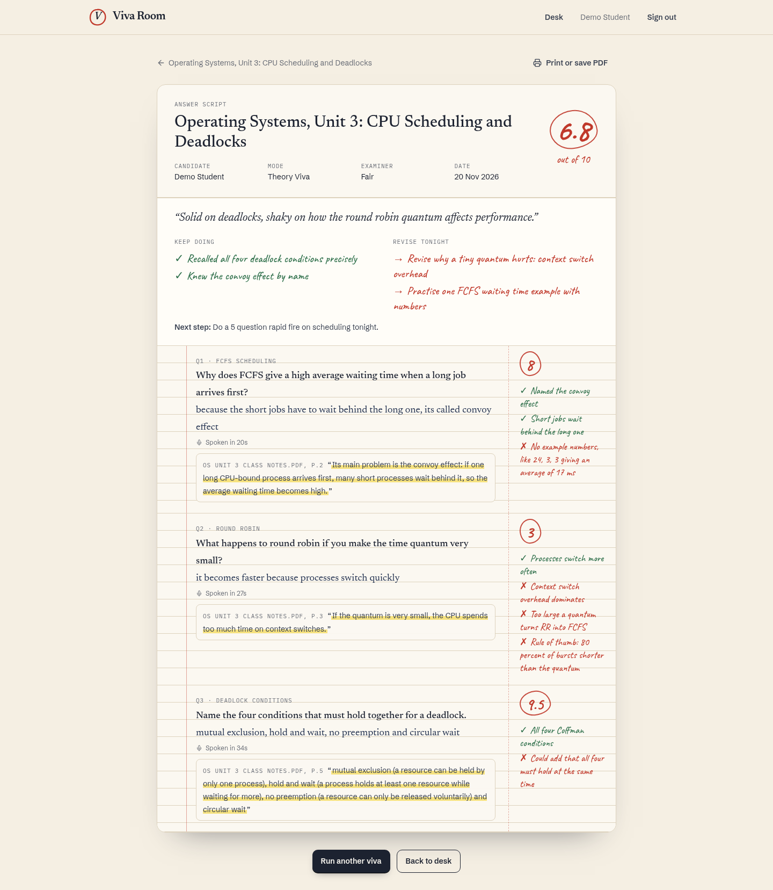
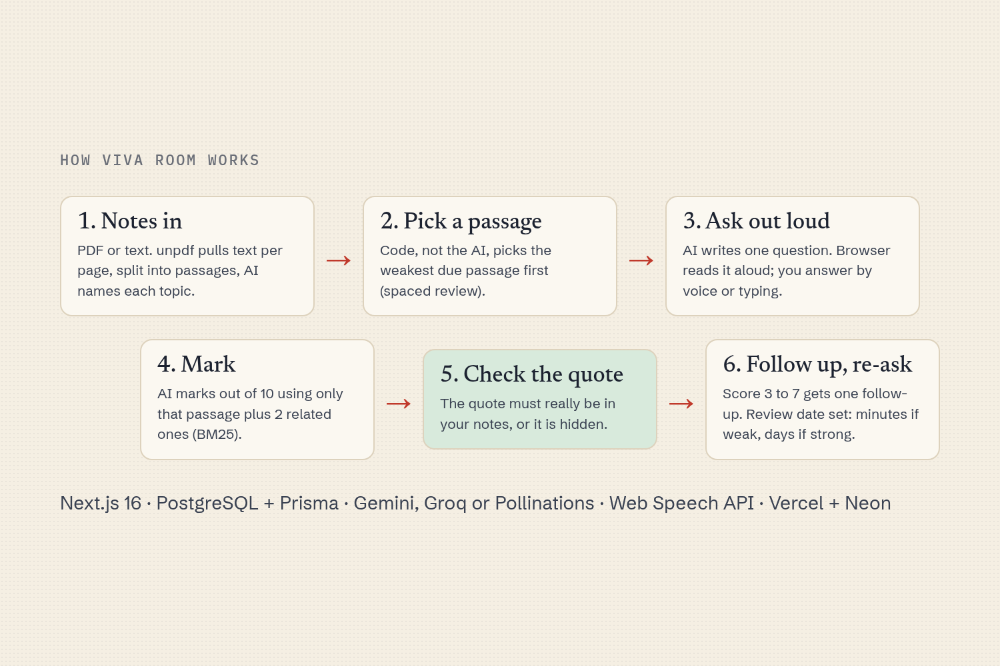

# Viva Room

Rehearse your viva out loud, from your own notes.

Upload your class notes. An AI examiner asks you questions out loud, listens to your spoken answer, marks it out of 10 like an answer script, and shows you the exact line in your notes that you missed. Passages you get wrong come back in your next viva until you get them right.

Built by Paladugu Varshith Chowdary (B.Tech Data Science, Malla Reddy University, Hyderabad) for **Build Your First AI App 2026** on Devpost.

- **Live app:** LIVE_URL
- **Demo video:** VIDEO_URL
- **Try it in one click:** press "Try it with sample notes" on the home page. It makes a private throwaway account with sample Operating Systems notes. Or sign in as `demo@vivaroom.app` / `viva-demo`.



## The problem

In Indian engineering colleges almost every lab course ends with a viva, and many theory courses have one too. Students prepare by reading notes silently, but a viva is spoken. The hard part is not remembering a fact; it is explaining it out loud while someone waits, and then handling the follow-up question when your first answer was half right. Flashcard apps test recall. Chatbots answer your questions instead of asking you theirs, and they mark against whatever they know, not against what your professor taught.

## What it does

1. **Notes in.** Upload a PDF, a .txt or .md file, or paste text. Viva Room splits it into passages, keeps the page number of each one, and has the AI label every passage with a syllabus style topic.
2. **Viva.** Pick a mode (Lab viva, Theory viva, Rapid fire), an examiner (kind, fair, strict) and a length. The examiner reads each question out loud with the browser's speech engine. You answer by speaking (Web Speech API, Indian English) or by typing.
3. **Marking.** The answer is marked out of 10 against your own notes, with what you got right, what you missed, a two line model answer, and a quote from your notes.
4. **Follow-ups.** If you score between 3 and 7, the examiner asks one follow-up question about your main gap, the way a real examiner does.
5. **Spaced review.** Every passage keeps a review state. Weak passages become due again within minutes, strong ones in days. The next viva starts with what is due and weakest, and when it re-asks a passage it is told what you missed last time, so it asks about that gap from a new angle.
6. **Answer script.** At the end you get a printable answer script with red pen marks in the margin, closing remarks, and the topic map on the subject page updates.





## How the AI is used, and how it is kept honest



| Step | What the model does | Guard rail in code |
|---|---|---|
| Topic labels | Names each passage in 2 to 5 words | Falls back to "General" if the call fails, the app still works |
| Question | Writes one speakable question from one passage, avoiding questions already asked | Passage choice is done by code (`lib/schedule.ts`), not by the model |
| Marking | Returns score, verdict, got, missed, model answer, a quote and an optional follow-up as JSON | The marker only sees the passage plus the two most related passages (BM25 search in `lib/text.ts`) |
| Quote | Copies the most useful sentence from the notes | `verifyQuote` checks the quote really exists in the notes (exact or 85% word overlap). If it doesn't, the quote is hidden and the UI says so |
| Closing remarks | Summarises the viva | Falls back to a plain average if the call fails |

The model never decides what counts as true. Your notes do.

**AI provider.** `lib/ai.ts` picks the first one that is configured:

1. Google Gemini (`GEMINI_API_KEY`, default model `gemini-2.5-flash`, free key from Google AI Studio)
2. Groq (`GROQ_API_KEY`, default `llama-3.3-70b-versatile`, free key)
3. If neither is set, the free keyless [Pollinations](https://pollinations.ai) text API. It allows about one reply every 45 seconds per IP, so calls are queued. Fine for trying it locally, too slow for a public deploy.

Speech in and out runs in the browser (Web Speech API and `speechSynthesis`), so no audio is uploaded or stored.

## Tech stack

- Next.js 16 (App Router, route handlers), React 19, TypeScript, Tailwind CSS 4
- PostgreSQL with Prisma 6 (Neon free tier on Vercel). The schema uses only portable types, so it also runs on SQLite locally
- Email and password auth with bcrypt hashes and a signed JWT cookie (`jose`)
- `unpdf` for PDF text extraction, `zod` for request validation
- Fonts: Newsreader, Schibsted Grotesk, IBM Plex Mono and Caveat (for the red pen), all from Fontsource. Icons from Lucide

Data model (`prisma/schema.prisma`): `User`, `Subject`, `Source` (an uploaded file), `Chunk` (a passage with its topic, page and review state), `Session` (one viva) and `Turn` (one question with its answer and marks).

API routes:

| Route | What it does |
|---|---|
| `POST /api/auth/signup`, `/login`, `/logout`, `/guest` | Accounts and the one-click sample account |
| `POST /api/subjects`, `DELETE /api/subjects/:id` | Subjects |
| `POST /api/subjects/:id/sources` | Upload a file (multipart) or pasted text (JSON) |
| `DELETE /api/sources/:id` | Remove a file and its passages |
| `POST /api/sessions` | Start a viva and get the first question |
| `POST /api/sessions/:id/answer` | Mark an answer, return the result and the next question or follow-up |
| `POST /api/sessions/:id/finish` | End early and write the closing remarks |
| `GET /api/health` | Database and AI provider status |

## Run it locally

Needs Node 20 or newer.

```bash
git clone https://github.com/varshith-dev/viva-room
cd viva-room
npm install
```

**Quickest, no database server (SQLite):**

```bash
npm run demo:sqlite        # creates prisma/.sqlite/local.db, seeds the demo account, starts next dev
```

**With PostgreSQL:**

```bash
cp .env.example .env       # set DATABASE_URL, AUTH_SECRET and, ideally, GEMINI_API_KEY
npx prisma db push
npm run db:seed
npm run dev                # http://localhost:3000
```

Tests for the passage splitter, BM25 search, quote check and review scheduler:

```bash
npm test
```

## Deploy on Vercel

1. Import the repo in Vercel. The build command comes from `vercel.json` (`npm run vercel-build`).
2. Add a Neon Postgres database from Vercel > Storage. It sets `DATABASE_URL` for you.
3. Add `GEMINI_API_KEY` (or `GROQ_API_KEY`) and `AUTH_SECRET` under Environment Variables.
4. Deploy. The build pushes the schema and seeds the demo account only if the database is empty.

## Credits and AI assisted development

- Sample notes in `lib/sample.ts` were written for this project. They cover standard Operating Systems topics found in any textbook.
- Libraries: Next.js, React, Prisma, Tailwind CSS, unpdf, jose, bcryptjs, zod, Lucide icons, Fontsource fonts. Each keeps its own license.
- AI models at run time: Google Gemini, Groq hosted Llama, or Pollinations, depending on configuration.
- I used an AI coding assistant while building this, for parts of the code and the README. The idea, product decisions, design direction, testing and the final review are mine.

## License

MIT
